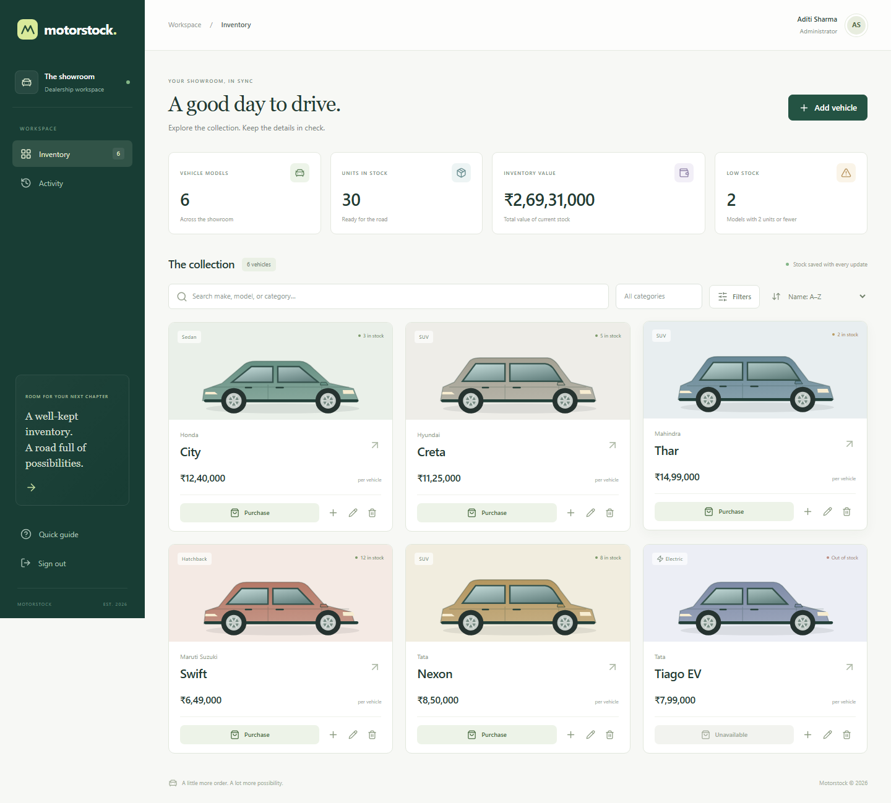
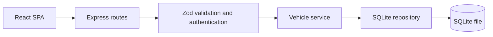
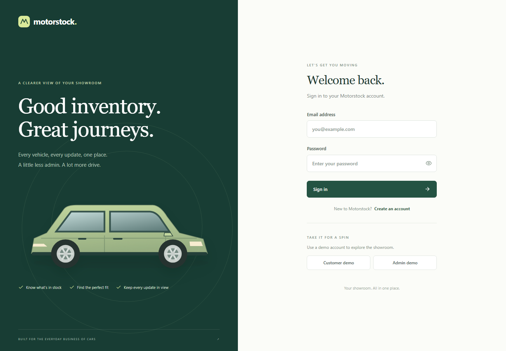
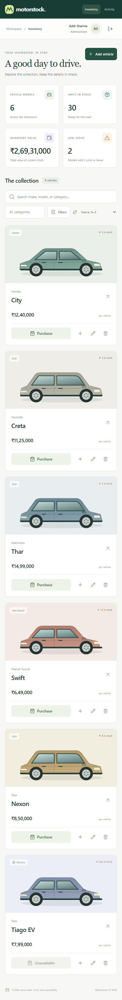
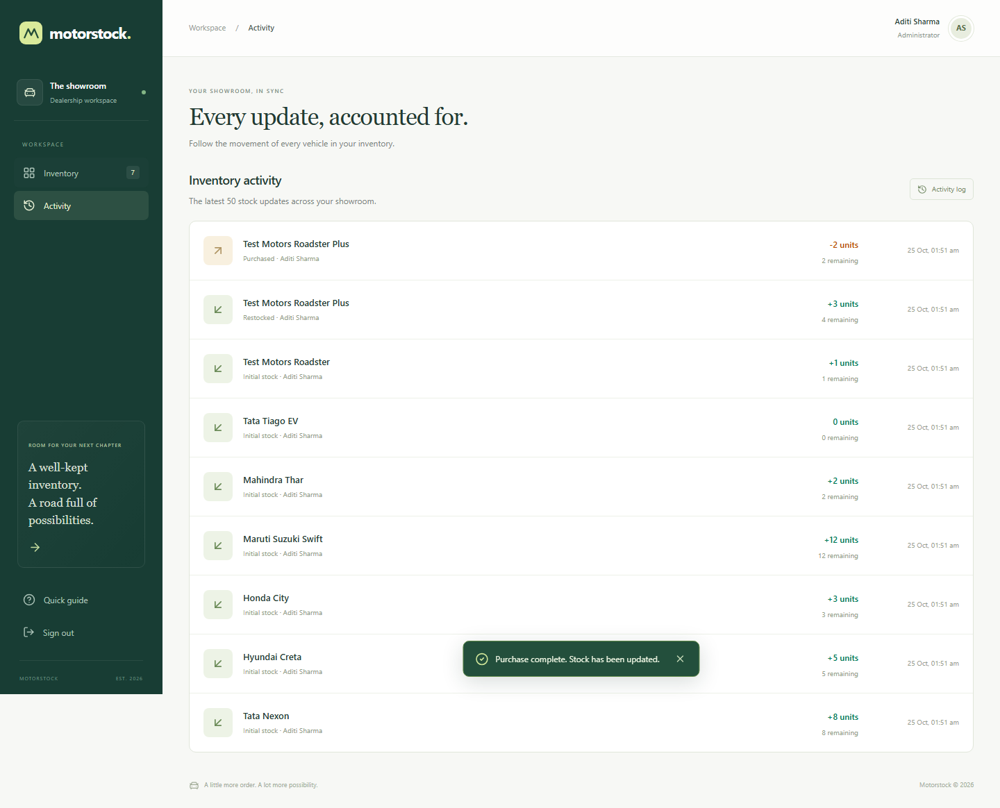

# Motorstock

A small car dealership inventory application built for the Car Dealership TDD Kata. Customers can find and purchase vehicles. Administrators can maintain the catalogue, replenish stock, and inspect inventory activity.

React, TypeScript, Tailwind CSS, Express and a persistent SQLite database. One repository, one database, and no external services needed to run locally.



## Run locally

Prerequisites: **Node.js 24.15 or newer** and **pnpm 11.25.0**. Node 24 supplies the SQLite driver; no database server or native driver installation is needed. If pnpm is missing, install it with `npm install -g pnpm@11.25.0`.

```sh
pnpm install --frozen-lockfile
pnpm setup:local
pnpm seed
pnpm dev
```

Open **http://localhost:5173**. The backend runs on **http://localhost:3001**. Vite forwards `/api` requests to the backend.

`setup:local` creates `.env` with a random JWT signing secret and leaves an existing `.env` alone. `seed` creates two demo accounts and six sample vehicles; rerunning it preserves existing accounts and does not duplicate vehicles in a nonempty catalogue. To use custom seed credentials, edit `.env` before the first seed. Accounts are never created automatically when the server starts.

| Account       | Email                 | Password           |
| ------------- | --------------------- | ------------------ |
| Administrator | `admin@demo.local`    | `AdminDemo123!`    |
| Customer      | `customer@demo.local` | `CustomerDemo123!` |

These credentials are public local demo credentials. A new registration always creates a customer. The demo buttons fill in these defaults; click **Sign in** to continue. For a real deployment, use private seed credentials and remove the demo shortcuts.

To run the frontend and backend in separate terminals, use `pnpm dev:web` and `pnpm dev:api`. If changing the backend port, also set `API_PROXY_TARGET=http://127.0.0.1:<port>` when starting Vite.

## What you can do

- Register, sign in, restore a session on reload, and sign out.
- Search make, model, or category; combine category, price and stock filters.
- Sort and paginate results; view total models, available units, stock value and low-stock counts.
- Purchase one or more units; sold-out vehicles have a disabled purchase button.
- As an administrator, add/edit/delete vehicles and restock them.
- Review the last 50 inventory movements, including actor, quantity and remaining stock.

The interface includes loading, empty, validation and request-error states, keyboard-accessible modal dialogs, mobile layouts, and confirmation before purchases/deletions. Vehicle illustrations are local SVG components and require no external image service.

## Design



The application is a modular monolith. Routes handle HTTP, validation rejects invalid inputs, the service coordinates business operations, and the repository owns parameterized SQL. Dependencies are passed explicitly, allowing each test to create an isolated app and database.

Stock updates use a conditional SQL update inside `BEGIN IMMEDIATE`. The quantity change and movement insert commit together or roll back together. Two buyers cannot both take the last unit. Money is stored as integer paise and exposed as rupees, avoiding floating-point accumulation in stored prices. Database constraints independently prevent negative stock and invalid roles.

Read [the design notes](docs/DESIGN.md) for schema, tradeoffs, and a purchase walkthrough. Read [the API reference](docs/API.md) for payloads and responses.

## Permissions

| Action                | Customer | Administrator |
| --------------------- | -------- | ------------- |
| List/search/purchase  | Yes      | Yes           |
| Add/update/delete     | No       | Yes           |
| Restock/view activity | No       | Yes           |

The kata explicitly restricts deletion and restocking to administrators. This implementation also restricts catalogue creation and editing to administrators, consistent with the requested admin UI. `PUT` changes descriptive details and price; quantity changes go through the purchase/restock endpoints so they appear in the activity log.

JWTs expire after two hours. The server looks up the current user and role for every protected request, rather than trusting a client-supplied role. Passwords are hashed with bcrypt at cost 12. Authentication endpoints have a 30-request / 15-minute IP limit. Helmet sets security headers; JSON payloads are limited to 16 KB; unexpected errors have a generic response and a request ID.

## Tests and TDD

```sh
pnpm test                 # API/config tests using temporary SQLite files
pnpm test:coverage        # Coverage with enforced thresholds
pnpm exec playwright install chromium
pnpm test:e2e             # Chromium tests; starts isolated API + frontend
pnpm build               # Type-check, build React, compile the API
pnpm format:check
```

The backend began with two recorded Red–Green cycles: 12 failing authentication tests, then the passing implementation; 33 failing inventory tests, then the passing implementation. A later regression cycle demonstrates and fixes bcrypt's Unicode byte-limit edge case, with a simultaneous-registration test as well. Other commits add the frontend, browser tests, configuration tests, and a formatting refactor. There are no backdated commits or invented earlier development steps.

The tests cover authentication, duplicate accounts, role escalation, expired tokens, search/filter validation, pagination, integer money, persistence across database reopen, concurrent purchase requests, stock overflow, and rollback when recording a stock movement fails. Browser tests cover admin CRUD/restock/purchase, customer filtering and purchase, registration, session restoration, logout, errors, desktop screenshots and mobile overflow.

See [the test report](docs/TEST_REPORT.md) and [captured command output](docs/test-results.txt). Local HTML reports are generated in `coverage/` and `playwright-report/`. GitHub Actions runs formatting, coverage, production build and browser checks, and uploads reports as artifacts.

## Production build

```sh
pnpm build
pnpm start
```

Open **http://localhost:3001**. Express serves both the built SPA and API from one origin. Keep `.env` private and store `data/dealership.db` on a persistent disk. Back up the database, including its WAL state using a SQLite-aware backup, rather than copying an active database file alone.

Optional Docker setup:

```sh
docker build -t motorstock .
docker run --rm --env-file .env -v motorstock-data:/app/data motorstock node dist/server/seed.js
docker run --rm --env-file .env -p 3001:3001 -v motorstock-data:/app/data motorstock
```

The container recipe is supplied for convenience; see the test report for whether Docker was executed in the development environment.

## Scope and limitations

This is a toy inventory system. A purchase updates inventory; it does not process payments, create an order, or collect personal buyer details. Duplicate submissions are prevented while the confirmation dialog is busy, but network retries have no idempotency key. The app refreshes after its own mutations; it has no live push updates across clients.

SQLite and synchronous queries suit a small, single-instance app. The in-process rate limiter, global summaries and substring search are deliberate small-scale choices. For multiple API instances, use a server database, a shared rate-limit store and an indexed search strategy. There is no password reset, email verification, refresh/revocation system, or full catalogue-edit audit. Tokens live in session storage for this demo; production auth would need a considered cookie/session strategy, HTTPS and stricter deployment controls.

## Screenshots

Screenshots are captured from the working app by the browser suite.

| Sign in                                  | Mobile inventory                                 |
| ---------------------------------------- | ------------------------------------------------ |
|  |  |



## My AI Usage

**Tool used:** OpenAI Codex in the desktop app.

Codex read the supplied kata, proposed the architecture, wrote the initial failing backend tests, implemented the API/database layers, built the React/Tailwind interface, added browser tests, debugged the form-label and browser-test locator issues, and prepared the documentation and local verification commands. The implementation in this repository was produced with substantial AI assistance, not just autocomplete. AI-assisted commits include a `Co-authored-by: Codex <AI@users.noreply.github.com>` trailer.

The recorded workflow shows that AI can quickly connect a full-stack implementation, but generated code and tests still need execution and review: browser checks found issues that type checking and API tests did not catch. The red/green commits and captured results make that work inspectable. No claim is made that a human manually authored or independently reviewed code when that has not happened. The submitter should run the app, review the code and add their own honest reflection before discussing it in an interview.

[PROMPTS.md](PROMPTS.md) contains verbatim user-visible prompts and assistant replies exported from this development chat, rather than an AI-generated summary. The export script is included at `scripts/export-chat.mjs`.
