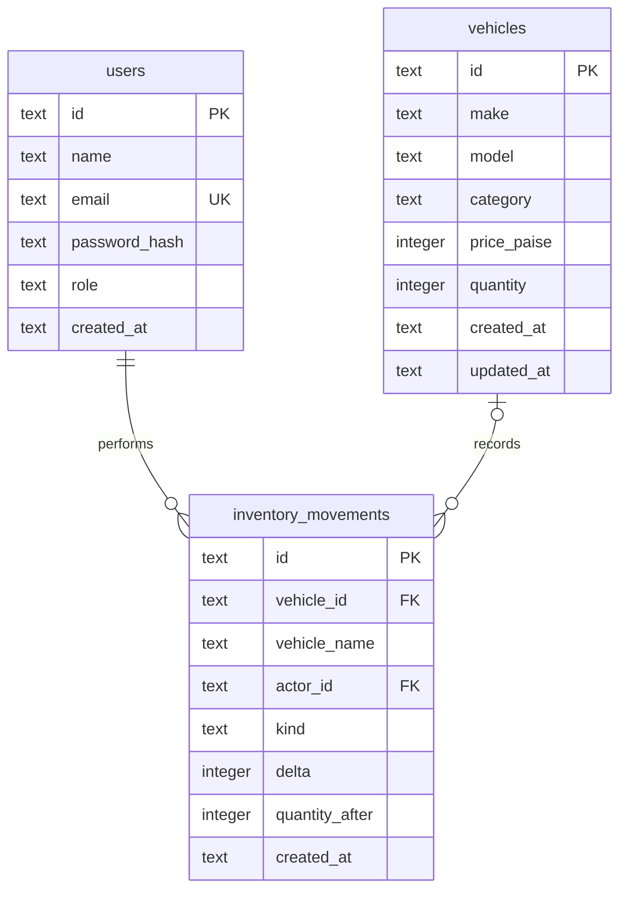

# Design notes

## Boundaries

The system has a React client, one Express process and one SQLite file. HTTP routes authenticate, authorize and validate requests before calling a service. `VehicleService` owns transactional use cases; `VehicleRepository` owns SQL and row mapping. `createApp` accepts an open database and signing secret, so tests do not need a network listener or the real development database.

The auth module is intentionally smaller: two write/read flows do not need a generic repository abstraction. No message queue, cache, service registry or microservice layer is needed at this scale.

## Data model

`PRAGMA user_version` tracks two ordered migrations. On startup, missing migrations run in explicit transactions. Existing user records survive the inventory migration. `STRICT` tables, foreign keys and `CHECK` constraints defend stored data independently of API validation. The quantity range is 0–1,000,000; a price is a positive integer number of paise. Make/model combinations are not unique because the kata only requires a unique vehicle ID.

Deleting a vehicle sets historical `vehicle_id` values to null. The movement's vehicle name remains available. Movement history records stock changes, not every catalogue edit or deletion.

## Purchase walkthrough

1. Verify the JWT signature/expiry, then load the user from SQLite.
2. Validate the UUID and positive integer quantity.
3. Begin an immediate transaction, acquiring the SQLite write reservation.
4. Execute `UPDATE ... SET quantity = quantity - ? WHERE ... AND quantity - ? >= 0 RETURNING *` (implemented with a signed delta and an upper bound as well).
5. If no row changed, distinguish a missing vehicle (`404`) from insufficient stock (`409`).
6. Insert the actor, stock delta, resulting quantity and vehicle snapshot into the movement table.
7. Commit; on any error, roll back both writes.

No asynchronous work occurs inside this transaction. WAL mode allows readers alongside a writer, and a five-second busy timeout tolerates brief lock contention. An API test deliberately aborts the movement insert and verifies that the stock change rolls back. Five simultaneous HTTP purchase requests for a single remaining unit result in exactly one success.

## Search and pagination

All values are bound parameters. The few SQL identifiers and sort clauses come from fixed application allowlists. Search strings escape `%`, `_` and `\` so users cannot inject wildcard patterns. Numeric price and category indexes support common filters; leading-wildcard make/model/free-text search still scans rows. Pages contain at most 100 records and use a deterministic ID tie-breaker. At higher scale, use full-text search and cursor pagination rather than claiming these queries are universally indexed.

## Operational choices

- **Deployment:** built SPA and API share an origin, avoiding unnecessary CORS configuration. Development uses a Vite proxy.
- **Sessions:** short-lived bearer JWTs, read from session storage; logout clears the local copy. An issued token remains valid until expiry. This demo does not promise immediate server-side logout revocation.
- **Administrator provisioning:** explicit seed command using environment credentials; registration cannot assign roles. Seed never promotes an existing customer or replaces existing passwords.
- **Errors:** one JSON error handler, generic server failures and request IDs. Auth errors do not expose password hashes.
- **Validation:** full-body PUT for catalogue details; separate stock commands preserve inventory history. Schemas reject unknown fields.
- **Observability:** health check and error logging. No metrics pipeline or full request log is claimed.
- **Testing:** temporary file-backed databases per API test; isolated browser-test database distinct from local demo data. The browser suite starts and stops its own servers.

For larger deployments, the next changes would be PostgreSQL with equivalent transactions, idempotent purchase requests backed by order records, cookie-based sessions with CSRF handling, a shared rate limiter, operational metrics and a richer audit trail. They are outside this kata's core flow.
